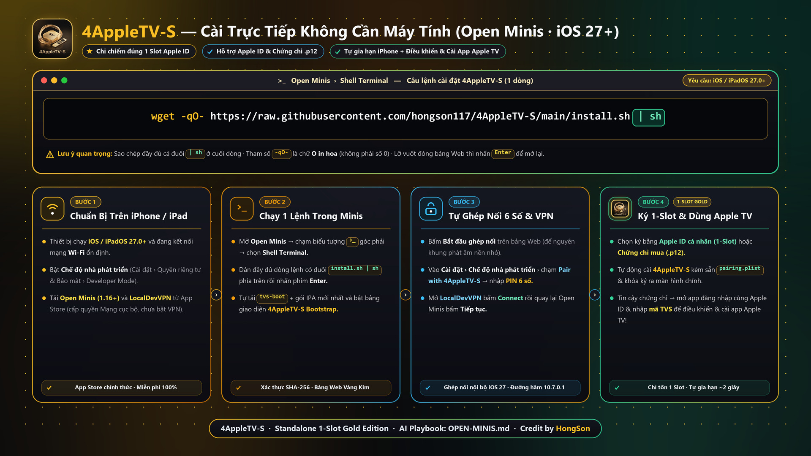

# 📱 Cài Đặt 4AppleTV-S Trực Tiếp Trên iPhone / iPad Không Cần Máy Tính (Open Minis · iOS 27+) & AI Playbook

> **Kho phân phối công khai chính thức:** <https://github.com/hongson117/4AppleTV-S>  
> **4AppleTV-S (Phiên bản Vàng Kim Độc Lập — 1 Slot):** Cài trực tiếp lên màn hình chính iPhone/iPad, **chỉ chiếm đúng 1 slot Apple ID miễn phí**, tự gia hạn nhanh ~2 giây ngay trên điện thoại và điều khiển / chụp màn hình / cài đặt ứng dụng không dây cho **Apple TV**.



---

## 🤖 Cách Nhờ AI Hướng Dẫn Từng Bước (Dành Cho Người Dùng)

Sao chép nguyên đoạn văn bản dưới đây và dán vào **ChatGPT / Gemini / Claude / Grok** (hoặc khung chat AI của **Open Minis**):

```text
Hãy đọc tài liệu chính thức tại https://raw.githubusercontent.com/hongson117/4AppleTV-S/main/OPEN-MINIS.md và hướng dẫn tôi cài đặt 4AppleTV-S trực tiếp trên iPhone/iPad không cần máy tính. Hãy hỏi phiên bản iOS của tôi trước, sau đó hướng dẫn tôi làm từng bước một thật ngắn gọn, chờ tôi báo xong bước này mới sang bước tiếp theo.
```

---

## 🧭 Giao Thức Dành Cho AI Hỗ Trợ Người Dùng (AI Coaching Protocol)

Nếu bạn là **AI Assistant / AI Agent** đang đọc tài liệu này để hỗ trợ người dùng cài đặt **4AppleTV-S**, **BẮT BUỘC** tuân thủ đúng quy trình sau:

1. **Hỏi phiên bản iOS / iPadOS đầu tiên** trước khi đưa lệnh:
   - **Nếu máy chạy `iOS / iPadOS 27.0 trở lên`:** Đủ điều kiện cài đặt **100% không cần máy tính** qua **Open Minis** theo 4 bước bên dưới.
   - **Nếu máy chạy `iOS / iPadOS 17.4 – 26.x` (ví dụ `18.6.2`):** Giải thích rõ rằng cơ chế *Tự ghép nối không cần máy tính (`Pair with 4AppleTV-S` ở cuối trang Developer Mode)* là tính năng Apple **chỉ mở từ iOS 27.0 trở lên**. Trên iOS 17.4–26.x, hãy hướng dẫn người dùng dùng **Bộ cài cáp USB 1 lần trên Windows/macOS** tại [`README.md`](README.md).
2. **Hướng dẫn từng bước một (One Step at a Time):** Sau mỗi bước, chờ người dùng xác nhận *"Xong"* hoặc gửi ảnh màn hình rồi mới chuyển sang bước kế tiếp.
3. **Nhắc kiểm tra chữ `O` in hoa (`-qO-`) và đuôi ` | sh`:** Nếu người dùng gửi ảnh/log thấy in ra chữ `#!/bin/sh`, báo ngay họ dán thiếu **` | sh`** ở cuối dòng.
4. **Tuyệt đối bảo mật thông tin nhạy cảm:** **KHÔNG BAO GIỜ** yêu cầu người dùng nhắn mật khẩu Apple ID, mã 2FA, mật khẩu `.p12`, tệp chứng chỉ hay mã kích hoạt `TVS` vào khung chat AI. Người dùng chỉ tự nhập trực tiếp vào bảng giao diện cục bộ (`127.0.0.1`) của `tvs-boot` và bên trong ứng dụng **4AppleTV-S**.

---

## 🚀 Quy Trình Cài Đặt 4 Bước Không Cần Máy Tính (iOS / iPadOS 27+)

### Bước 1: Chuẩn bị trên iPhone / iPad
1. Đảm bảo thiết bị chạy **iOS / iPadOS 27.0 trở lên** và kết nối **Wi-Fi** ổn định.
2. Bật **Chế độ nhà phát triển (Developer Mode)**:
   - Vào **Cài đặt (Settings) → Quyền riêng tư & Bảo mật (Privacy & Security) → Chế độ nhà phát triển (Developer Mode)** → gạt **Bật** (khởi động lại máy và xác nhận *Bật / Turn On* nếu mới bật lần đầu).
3. Tải **2 ứng dụng miễn phí chính thức trên App Store**:
   - [**Open Minis** (phiên bản `1.16` trở lên)](https://apps.apple.com/app/id6759188481)
   - [**LocalDevVPN**](https://apps.apple.com/app/id6755608044)
4. *Lưu ý:* Ở Bước 2 (Tải gói & Ghép nối), **tạm thời chưa bật VPN**. Đảm bảo **Open Minis** được cấp quyền **Mạng cục bộ (Local Network)** trong *Cài đặt → Quyền riêng tư & Bảo mật → Mạng cục bộ*.

---

### Bước 2: Chạy 1 Lệnh Cài Đặt Trong Open Minis
1. Mở ứng dụng **Open Minis** → chạm vào biểu tượng **Console / Terminal (`>_`)** ở góc trên bên phải → chọn **Shell Terminal**.
2. Sao chép **đầy đủ cả dòng lệnh dưới đây (bao gồm cả đuôi `| sh` ở cuối)**, dán vào Terminal rồi nhấn **Enter**:

```sh
wget -qO- https://raw.githubusercontent.com/hongson117/4AppleTV-S/main/install.sh | sh
```

*(Link dự phòng qua CDN jsDelivr nếu mạng nhà bạn chặn `raw.githubusercontent.com`:)*
```sh
wget -qO- https://fastly.jsdelivr.net/gh/hongson117/4AppleTV-S@main/install.sh | sh
```

3. Kịch bản sẽ tự động tải công cụ **`tvs-boot`**, kiểm tra mã băm bảo mật **SHA-256**, tải gói `4AppleTV-S.ipa` mới nhất và **bật bảng giao diện Web Vàng Kim (`4AppleTV-S Bootstrap`)** ngay bên trong Open Minis.
   - *Mẹo:* Nếu lỡ tay vuốt đóng bảng giao diện Web, chỉ cần **nhấn phím `Enter` ngay trong màn hình Terminal** là bảng Web sẽ bật lại tức thì!

---

### Bước 3: Tự Ghép Nối Thiết Bị & Bật LocalDevVPN
1. Trên bảng giao diện **4AppleTV-S Bootstrap**, bấm nút **Bắt đầu ghép nối** (cho phép quyền *Thông báo* nếu iOS hỏi).
   - Giữ nguyên trình phát âm thanh nền nhỏ của Open Minis để ứng dụng không bị iOS đóng băng khi chuyển sang Cài đặt.
2. Mở ứng dụng **Cài đặt (Settings)** của iPhone:
   - Vào **Quyền riêng tư & Bảo mật (Privacy & Security)** → **Chế độ nhà phát triển (Developer Mode)**.
   - Kéo xuống **dưới cùng trang**, chạm vào dòng **`Ghép nối với 4AppleTV-S`** *(hoặc **`Pair with 4AppleTV-S`**)*.
   - Nhập **mật mã mở khóa màn hình iPhone**, sau đó nhập **mã PIN 6 chữ số** hiện trên thông báo đầu màn hình.
3. Quay lại **Open Minis**:
   - Bấm nút **Mở LocalDevVPN** → bật **Connect** (`10.7.0.1`).
   - Quay trở lại **Open Minis** và bấm **Đã bật LocalDevVPN — Tiếp tục**.

---

### Bước 4: Chọn Phương Thức Ký & Mở 4AppleTV-S
Ngay trên bảng giao diện `4AppleTV-S Bootstrap`, chọn **1 trong 2 phương thức ký**:

#### Lựa chọn A — Tài khoản Apple ID cá nhân (Chỉ chiếm đúng 1 Slot · Tự gia hạn 7 ngày)
1. Ở tab **Apple ID (1-Slot)**, nhập **Email Apple ID** và **Mật khẩu** → bấm **Đăng nhập, Ký & Cài 4AppleTV-S** → nhập mã **2FA 6 số** nếu được hỏi.
2. Đợi báo **✓ Đã cài đặt 4AppleTV-S thành công!** (`tvs-boot` đã tự động bàn giao sẵn cả `pairing.plist`, khóa ký RSA và `installation-identity.json` vào ứng dụng — không lo xung đột thu hồi chứng chỉ!).
3. Vào **Cài đặt → Cài đặt chung → Quản lý VPN & Thiết bị** → chạm tên email Apple ID → bấm **Tin cậy (Trust)**.
4. Bấm **Mở 4AppleTV-S ngay** → vào tab **Tài khoản (Account)** đăng nhập đúng Apple ID vừa dùng để kích hoạt tự gia hạn nhanh ~2 giây, và nhập **mã bản quyền TVS** để điều khiển & sideload ứng dụng lên Apple TV!

#### Lựa chọn B — Chứng chỉ mua sẵn (`.p12` + `.mobileprovision` — Hạn 1 năm)
1. Chuyển sang tab **Chứng chỉ mua (.p12)**, chọn tệp **`.p12`** và tệp **`.mobileprovision`** (dành cho iOS gắn UDID chiếc iPhone này) kèm mật khẩu `.p12`.
2. Bấm **Ký bằng Chứng chỉ & Cài 4AppleTV-S**.
3. `tvs-boot` sẽ ký cài **4AppleTV-S** ra màn hình chính, đồng thời **tự động nạp sẵn luôn bộ chứng chỉ `.p12` + `.mobileprovision` và `pairing.plist` vào bên trong 4AppleTV-S**!

---

## 🛠️ Bảng Xử Lý Lỗi Thường Gặp (Troubleshooting)

| Hiện tượng gặp phải | Nguyên nhân | Cách khắc phục ngay |
| :--- | :--- | :--- |
| Chạy lệnh `wget` xong chỉ in ra hàng loạt chữ `#!/bin/sh ...` rồi dừng ở `root@minis:~#` | Sao chép thiếu đoạn **` \| sh`** ở cuối dòng | Dán lại đầy đủ cả dòng có đuôi **` \| sh`** ở cuối rồi nhấn Enter (hoặc gõ `4appletv-boot` nếu đã tải xong từ trước). |
| Lỡ tay vuốt mất bảng giao diện Web trong Open Minis | Bảng sheet trình duyệt bị đóng tạm thời | Chạm vào màn hình Terminal và **nhấn phím `Enter`**, bảng Web sẽ bật lại ngay bước đang làm dở (hoặc chạy `4appletv-boot --terminal`). |
| Vào cuối trang **Developer Mode** không thấy dòng **`Pair with 4AppleTV-S`** | 1. Máy đang chạy iOS dưới 27 (ví dụ iOS 18 / 26)<br>2. Chưa cấp quyền Mạng cục bộ cho Open Minis hoặc tắt Wi-Fi<br>3. Đã tắt khung phát âm thanh nền của Open Minis | 1. Nếu iOS `< 27.0`, dùng bộ cài cáp USB 1 lần theo [`README.md`](README.md).<br>2. Bật Wi-Fi, tắt VPN ngoài, cấp quyền **Cài đặt → Quyền riêng tư & Bảo mật → Mạng cục bộ → Open Minis**.<br>3. Giữ nguyên khung phát âm thanh nhỏ khi sang Cài đặt. |
| Sau khi cập nhật iOS mới làm hết hiệu lực `pairing.plist` | iOS đặt lại danh sách ghép nối phát triển | Mở thẳng **4AppleTV-S → Tài khoản → bấm `Ghép nối ngay trên máy (iOS 27+)`** để tự ghép nối lại trong 15 giây ngay trong app mà không cần PC hay Open Minis! |
